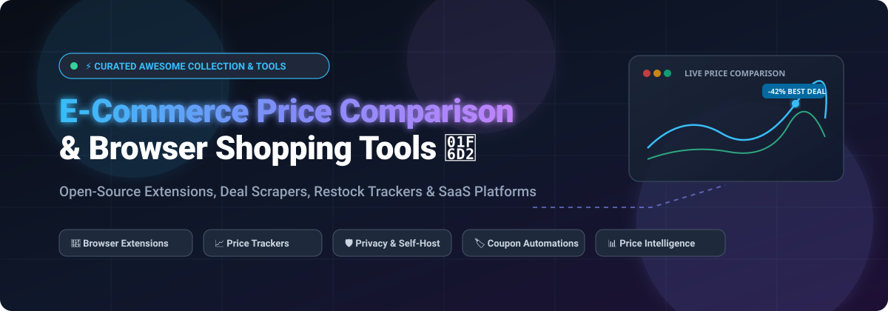

  

  

# 🛒 Awesome E-Commerce Price Comparison & Browser Tools 🏷️

**The definitive, SEO-optimized directory of SaaS platforms, open-source browser extensions, web scrapers, price drop monitors, coupon automators, and real-time deal finders.**

*Discover privacy-focused shopping add-ons, self-hosted product price trackers, historical price charts, and multi-retailer price intelligence engines.*

---

## 📑 Table of Contents
- [🔍 Sector Overview & Market Dynamics](#-sector-overview--market-dynamics)
- [☁️ SaaS & Hosted Platforms](#️-saas--hosted-platforms)
- [💻 Open-Source GitHub Projects](#-open-source-github-projects)
  - [📦 Standalone Trackers & Extensions](#-standalone-trackers--extensions)
  - [🛠️ Scraping Engines & Extension Frameworks](#️-scraping-engines--extension-frameworks)
- [🤝 How to Contribute](#-how-to-contribute)
- [💖 Support & Sponsorship](#-support--sponsorship)
- [⭐ Star History](#-star-history)
- [⚠️ Disclaimer](#️-disclaimer)

---

## 🔍 Sector Overview & Market Dynamics

The global price comparison and shopping assistant market is estimated at **$5.8 billion to $7.2 billion**, compounding at over 11% annually alongside the worldwide expansion of multi-merchant e-commerce and retail media networks. 

From a structural standpoint, the consumer segment is **moderately concentrated** with high barriers to distribution, exhibiting "winner-take-most" network effects dominated by well-capitalized checkout and banking platforms (such as Capital One Shopping, PayPal Honey, and Klarna). Conversely, the self-hosted, developer tooling, and specialized scraping sectors remain **highly fragmented**, as privacy-conscious shoppers and indie hackers increasingly migrate away from telemetry-heavy commercial extensions toward transparent, open-source web monitors and local browser extensions.

---

## ☁️ SaaS & Hosted Platforms

A curated comparison of enterprise shopping assistants, price history trackers, and affiliate coupon platforms, sorted in descending order by **company size / valuation / market capitalization**.

| 🏢 Company / Product | 📊 Company Size (Valuation / Revenue) | 💳 Pricing | 🎁 Free Tier Limits | 📝 Description |
| :--- | :--- | :--- | :--- | :--- |
| **[Capital One Shopping](https://capitaloneshopping.com)** | Valuation: ~$115B (Market Cap) / Revenue: ~$69.3B (Parent: Capital One Financial Corp.) | $0 / Free | Free forever; unlimited coupon code discovery and real-time merchant comparisons across 30,000+ supported stores. | Browser add-on and web portal comparing real-time prices across competing retailers, factoring in shipping and tax, and applying coupon codes automatically. |
| **[PayPal Honey](https://joinhoney.com)** | Valuation: ~$45B (Market Cap) / Revenue: ~$33.2B (Parent: PayPal Holdings; acquired for $4B) | $0 / Free | Free forever; unlimited automated promo code testing, coupon discovery, and Droplist price tracking for consumers. | Popular browser extension that automatically searches and applies promo codes at checkout while offering Amazon price history tracking and Droplist alerts. |
| **[Rakuten](https://rakuten.com)** | Valuation: ~$8.5B (Market Cap) / Revenue: ~$17.1B (Parent: Rakuten Group, Inc.) | $0 / Free | Free forever; unlimited browser cash-back activation, promo code application, and automated deal notifications across 3,500+ stores. | Browser extension combining automatic promo code application, cross-merchant price comparison alerts, and affiliate cashback rewards across thousands of stores. |
| **[Klarna](https://klarna.com)** | Valuation: ~$5.0B (Market Cap) / Revenue: ~$4.1B | $0 / Free (Core Extension & App) | Free forever; unlimited cross-store price comparison alerts, coupon finder, and price-drop tracking (optional Pay in 4 credit features apply fees/interest on late payments). | Shopping assistant and browser extension offering cross-store price comparisons, price-drop notifications, automatic coupon testing, and flexible checkout options. |
| **[Idealo](https://idealo.co.uk)** | Revenue: ~$300M+ (Parent: Axel Springer, valued at ~$15B) | $0 / Free | Free forever; unlimited product searches, price history graphs, and email price alerts across 50,000+ online merchants. | Leading European price comparison platform and mobile/browser tool tracking live retailer pricing, dynamic price alerts, and historical pricing trends. |
| **[PriceSpy (Prisjakt)](https://pricespy.co.uk)** | Valuation: ~SEK 675M (~$62M) / Revenue: ~SEK 529M (~$49M) (Parent: eEquity / Nasdaq First North) | $0 / Free | Free forever; unlimited product comparisons, multi-store price history charts, and push/email price-drop alerts. | Comprehensive European price and product comparison engine indexing millions of offers, shipping costs, historical price curves, and verified store reviews. |
| **[Keepa](https://keepa.com)** | Bootstrapped / Estimated Revenue: ~$15M–$25M | €29/month (~$31/month) or €290/year; API starts at €49/month | Free forever: embeds basic 90-day price history graphs and allows tracking up to 200 items (locks Sales Rank history, Buy Box statistics, and bulk export behind €29/mo Pro). | Detailed Amazon price history extension embedding interactive price-drop graphs, Lightning Deal trackers, and international Amazon marketplace comparisons directly onto product pages. |
| **[CamelCamelCamel](https://camelcamelcamel.com)** | Bootstrapped / Estimated Revenue: ~$5M–$10M (Cosmic Shovel, Inc.) | $0 / Free | Free forever; unlimited Amazon price history lookups, wishlist tracking imports, and email/RSS price-drop alerts. | Long-running Amazon price tracker providing historical price charts, third-party seller comparisons, and email or RSS price-drop alerts via the Camelizer extension. |
| **[InvisibleHand](https://getinvisiblehand.com)** | Acquired (Deal size: ~$300K, via Skimlinks / CNET Shopping) | $0 / Free | Free forever; unlimited automated competitor price comparison alerts across retailers, flights, and hotels. | Discreet browser extension that displays a non-intrusive notification banner whenever a viewed product, flight, or hotel is available cheaper on another site. |
| **[PriceZombie](https://wikipedia.org)** | Bootstrapped / Historical (Shut down 2016) | $0 / Free (Historical) | Free forever until service retirement in 2016; supported tracking unlimited product price histories across supported retail stores. | Notable early browser extension and price-comparison aggregator that tracked multi-retailer price histories and alerted shoppers to fake discounts before shutting down. |

---

## 💻 Open-Source GitHub Projects

Explore community-driven price tracking systems, self-hosted alert monitors, and privacy-first browser extensions. Each open-source project includes a live GitHub Stars_Badge linking directly to its stargazers page, sorted by Stars_Count in descending order.

### 📦 Standalone Trackers & Extensions

| 🏷️ Project | ⭐ GitHub_Stars | 📖 Description |
| :--- | :--- | :--- |
| **[Huginn (`huginn/huginn`)](https://github.com/huginn/huginn)** |  | Self-hosted automation agent system capable of scraping e-commerce product pages, tracking price deltas, and triggering custom webhook or email deal alerts. |
| **[Changedetection.io (`dgtlmoon/changedetection.io`)](https://github.com/dgtlmoon/changedetection.io)** |  | Self-hosted web page and e-commerce price monitor featuring visual selector targeting, Playwright JS rendering, restock detection, and multi-channel notifications. |
| **[SingleFile (`gildas-lormeau/SingleFile`)](https://github.com/gildas-lormeau/SingleFile)** |  | Open-source browser extension for archiving complete product pages and price listings as self-contained HTML files for proof-of-price and warranty claims. |
| **[PriceAI (`dimthink/PriceAI`)](https://github.com/dimthink/PriceAI)** |  | Open-source price aggregation and comparison tool indexing multi-channel SaaS and AI subscription pricing, displaying real-time lowest price, stock, and purchase links. |
| **[Streetmerchant (`jef/streetmerchant`)](https://github.com/jef/streetmerchant)** |  | High-speed, self-hosted stock and price-drop checker supporting dozens of major online retailers and dispatching instant alerts via Discord, Telegram, SMS, or Email. |
| **[PriceBuddy (`jez500/pricebuddy`)](https://github.com/jez500/pricebuddy)** |  | Self-hosted product price tracking application with interactive historical price charts, automated scraping intervals, multi-store support, and customizable alert thresholds. |
| **[Price-Tracking-Web-Scraper (`techwithtim/Price-Tracking-Web-Scraper`)](https://github.com/techwithtim/Price-Tracking-Web-Scraper)** |  | Full-stack e-commerce price tracking application built with Bright Data web unlocker, Playwright, React, and Flask. |
| **[Open Food Facts Server (`openfoodfacts/openfoodfacts-server`)](https://github.com/openfoodfacts/openfoodfacts-server)** |  | Collaborative open database enabling barcode-based grocery lookup, nutritional comparison, and Open Prices integration. |
| **[PriceGhost (`clucraft/PriceGhost`)](https://github.com/clucraft/PriceGhost)** |  | Self-hosted, lightweight price tracking application that monitors product prices from any website and alerts you when discounts go live. |
| **[Awesome-OpenPrice (`bytedoger/awesome-OpenPrice`)](https://github.com/bytedoger/awesome-OpenPrice)** |  | Open-source subscription price aggregation and comparison directory comparing official prices against third-party merchant offerings. |
| **[Discount Bandit (`Cybrarist/Discount-Bandit`)](https://github.com/Cybrarist/Discount-Bandit)** |  | Self-hosted price tracker built with Laravel that monitors product URLs across online stores and dispatches instant drop notifications. |
| **[PriceWise (`adrianhajdin/pricewise`)](https://github.com/adrianhajdin/pricewise)** |  | Modern Next.js e-commerce price tracker utilizing Bright Data web scraping, cron automation, MongoDB price history tracking, and automated email alerts. |
| **[Open Prices (`openfoodfacts/open-prices`)](https://github.com/openfoodfacts/open-prices)** |  | Crowdsourced global open database of grocery prices allowing shoppers to compare retail store prices via barcode and receipt data. |
| **[Hikaku Extension (`hikaku-io/hikaku-extension`)](https://github.com/hikaku-io/hikaku-extension)** |  | Open-source browser extension for real-time e-commerce price comparison, helping shoppers find deals across storefronts without telemetry. |

---

### 🛠️ Scraping Engines & Extension Frameworks

Tools commonly leveraged by developers to construct custom price comparison engines, scraping pipelines, and browser shopping assistants:

| 🧰 Framework / Engine | ⭐ GitHub_Stars | 📖 Description |
| :--- | :--- | :--- |
| **[n8n (`n8n-io/n8n`)](https://github.com/n8n-io/n8n)** |  | Self-hosted workflow automation platform ideal for orchestrating scheduled price checks, comparing retailer feeds, and pushing alerts. |
| **[Playwright (`microsoft/playwright`)](https://github.com/microsoft/playwright)** |  | Cross-browser automation library essential for rendering dynamic carts, testing coupons, and extracting localized e-commerce pricing. |
| **[uBlock Origin (`gorhill/uBlock`)](https://github.com/gorhill/uBlock)** |  | Open-source content blocker paired with shopping tools to strip affiliate hijacking, dynamic pricing cookies, and retail telemetry. |
| **[Scrapy (`scrapy/scrapy`)](https://github.com/scrapy/scrapy)** |  | High-throughput Python web crawling framework used to build multi-retailer product matchers and historical deal databases. |
| **[Crawlee (`apify/crawlee`)](https://github.com/apify/crawlee)** |  | Production-grade crawling library engineered to extract structured `schema.org/Offer` pricing data reliably across JavaScript storefronts. |
| **[Plasmo (`PlasmoHQ/plasmo`)](https://github.com/PlasmoHQ/plasmo)** |  | Modern React & TypeScript browser extension framework, widely used for developing real-time DOM price-overlay and coupon extensions. |
| **[WXT (`wxt-dev/wxt`)](https://github.com/wxt-dev/wxt)** |  | Next-generation framework for building cross-browser extensions with Vite, HMR, and automated manifest generation for shopping assistants. |
| **[Privacy Badger (`EFForg/privacybadger`)](https://github.com/EFForg/privacybadger)** |  | EFF's browser extension blocking third-party trackers that e-commerce sites use for behavioral profiling and price discrimination. |
| **[WebExtension Polyfill (`mozilla/webextension-polyfill`)](https://github.com)** |  | Standard cross-browser library enabling developers to write unified Chrome, Firefox, Safari, and Edge price-comparison add-ons. |

---

## 🤝 How to Contribute

Contributions are warmly welcomed! Help keep this directory current, accurate, and valuable for deal hunters and developers.

1. 🍴 **Fork the repository** on GitHub.
2. 🌿 **Create a new branch** (`git checkout -b feature/new-tool`).
3. 📝 **Add/edit entries in `README.md`** following the existing tabular structure.
4. 💡 Ensure you include: tool name, official URL, transparent pricing, free tier limits, company valuation or Stars_Count badge, and a neutral description.
5. 🚀 **Submit a Pull Request** with a brief summary of what you added or updated.

---

## 💖 Support & Sponsorship

Thank you for visiting and supporting the **Awesome E-Commerce Price Comparison & Browser Tools** list! 🌟

If you find this repository helpful, please consider supporting the project:
- ⭐ **Star this repository** to help others discover it.
- 🍴 **Fork and share** with your network, fellow developers, and privacy-conscious shoppers.
- ☕ **Buy me a coffee / Sponsor the project** via the official [GitHub Sponsor Dashboard](https://github.com/sponsors/ishandutta2007) to help support ongoing maintenance and new features.

---

## ⭐ Star History

---

## ⚠️ Disclaimer

- This is a community-curated directory intended strictly for educational, research, and informational purposes. Inclusion does not imply endorsement.
- Many commercial browser shopping extensions monetize by injecting affiliate tracking cookies at checkout or gathering consumer browsing histories; carefully audit extension permissions or favor open-source tools when privacy is paramount.
- Automated web scraping, data extraction, and coupon testing must always respect target websites' Terms of Service, `robots.txt`, rate limits, and applicable laws.

---

Made with ❤️ for smart shoppers, browser extension developers, privacy advocates, and deal-automation builders worldwide.

